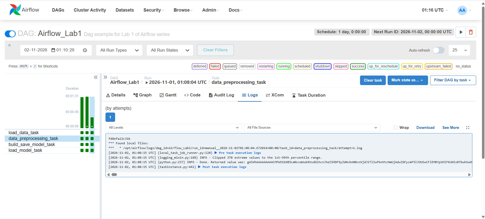
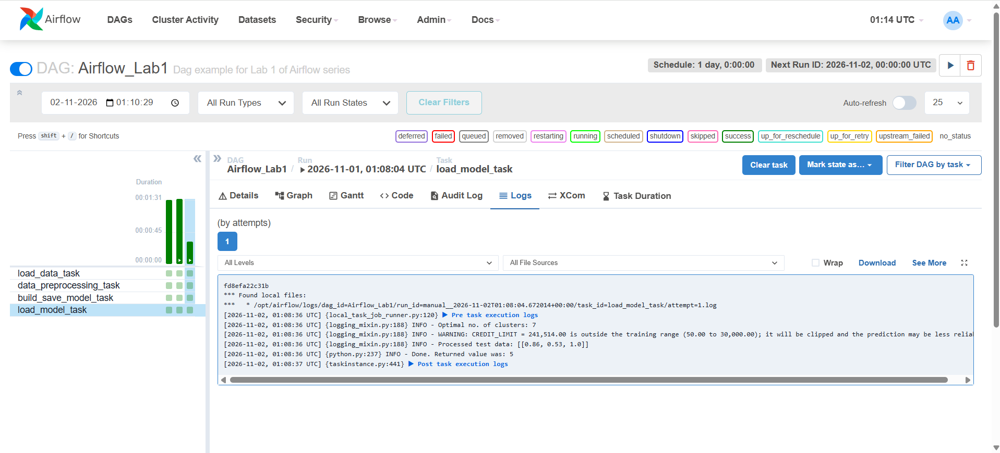

# Airflow Lab 1: Customer Clustering with Outlier Handling

This lab is based on [Airflow Lab 1](https://github.com/raminmohammadi/MLOps/tree/main/Labs/Airflow_Labs/Lab_1) from the MLOps course repository. The original lab uses Apache Airflow (running in Docker) to cluster credit card customers with K-Means and pick the number of clusters with the elbow method.

**My modification:** I added outlier handling to the preprocessing step, because the data is heavily skewed and a small number of extreme customers were distorting the model.

## What the pipeline does

The dataset (`dags/data/file.csv`) has 8,949 credit card customers (after dropping missing values). The pipeline groups similar customers based on three columns: `BALANCE`, `PURCHASES` and `CREDIT_LIMIT`. Airflow runs it as four tasks, one after another:

```
load_data_task → data_preprocessing_task → build_save_model_task → load_model_task
```

1. **load_data_task** reads the CSV file.
2. **data_preprocessing_task** cleans the data, handles outliers and scales it to 0–1.
3. **build_save_model_task** trains K-Means models for k = 1 to 49 and records the error (SSE) for each.
4. **load_model_task** uses the elbow method to find the best k and predicts the cluster for a test customer (`dags/data/test.csv`).

## What I changed

### The problem

All three columns have a long right tail: most customers have small balances and purchases, but a few have very large ones. The original code scaled the raw values straight to 0–1, so these few extreme customers stretched the scale and squeezed everyone else into a small part of it.

The test customer was also given to the model as raw, unscaled numbers, even though the model was trained on scaled data.

| Column | Skewness before | Skewness after |
|---|---|---|
| BALANCE | 2.39 | -0.86 |
| PURCHASES | 8.14 | -0.78 |
| CREDIT_LIMIT | 1.52 | -0.06 |

(A skewness near 0 means the values are spread out evenly. PURCHASES was by far the most skewed.)

### The fix

All changes are in `dags/src/lab.py` and are marked with `# CHANGE` comments.

1. **Clipping (in `data_preprocessing`).** Each column is limited to its 1st–99th percentile range from the training data. Values below the 1st percentile are raised to it, and values above the 99th percentile are lowered to it. This affected 370 values.
2. **Log transform (in `data_preprocessing`).** After clipping, `np.log1p` is applied to pull in the long tail. Then the data is scaled to 0–1 with `MinMaxScaler`, as in the original.
3. **Saving the preprocessing steps (in `data_preprocessing`).** The clipping bounds and the fitted scaler are saved to `dags/model/preprocessor.pkl`, so new data can be processed exactly the same way as the training data.
4. **Processing the test data the same way (in `load_model_elbow`).** The test customer now goes through the same clip → log → scale steps before prediction.
5. **Out-of-range warning (in `load_model_elbow`).** Before predicting, the pipeline compares each test value to the range seen in training and logs a warning if it falls outside it.

`dags/airflow.py` is unchanged apart from the `PythonOperator` import, which I switched to the Airflow 2 version so the DAG runs with the Airflow 2.9.2 setup from the lab instructions.

## Results

| | Original | With outlier handling |
|---|---|---|
| Optimal number of clusters (elbow) | 8 | **7** |
| Test customer's credit limit as given to the model | 241,514 (raw, unscaled) | **1.0** (within the 0–1 range) |
| Out-of-range warning | none | **CREDIT_LIMIT flagged** |

With the extreme values no longer stretching the data, the elbow method finds 7 clusters instead of 8.

The warning showed something important about the test customer: their credit limit is 241,514, while the highest credit limit in the training data is 30,000. In the original version, this went unnoticed: the value was passed to the model raw, and even if it had been scaled with the original method, it would have come out as 8.06 on a scale that should only go up to 1. The pipeline now catches this automatically, which shows why it matters to check that new data looks like the data the model was trained on.

### Screenshots

**data_preprocessing_task log:** 370 extreme values clipped.



**load_model_task log:** 7 clusters, out-of-range warning, processed test data within 0–1.



### Known limitation

As in the original lab, `build_save_model` saves the last model it trains (k = 49), not the model with the elbow-selected k. The elbow result (7) is reported in the log, but the test prediction (cluster 5) comes from the 49-cluster model. I kept this behaviour unchanged so that the effect of the outlier handling could be compared directly with the original.

## Project structure

```
Lab_1/
├── dags/
│   ├── data/
│   │   ├── file.csv          # credit card customer data
│   │   └── test.csv          # one test customer
│   ├── model/                # created when the DAG runs
│   ├── src/
│   │   ├── __init__.py
│   │   └── lab.py            # data processing and modelling functions (modified)
│   └── airflow.py            # the DAG
├── screenshots/
├── docker-compose.yaml
├── .env
└── README.md
```

## How to run it

**Prerequisites:** Docker Desktop running with at least 4 GB of memory.

1. **Download the Docker Compose file** (Airflow 2.9.2):

   ```bash
   # Mac / Linux
   curl -LfO 'https://airflow.apache.org/docs/apache-airflow/2.9.2/docker-compose.yaml'
   # Windows (PowerShell)
   curl.exe -o docker-compose.yaml https://airflow.apache.org/docs/apache-airflow/2.9.2/docker-compose.yaml
   ```

2. **Edit `docker-compose.yaml`** under `x-airflow-common` → `environment`:

   ```yaml
   AIRFLOW__CORE__LOAD_EXAMPLES: 'false'
   _PIP_ADDITIONAL_REQUIREMENTS: ${_PIP_ADDITIONAL_REQUIREMENTS:- pandas scikit-learn kneed}
   ```

3. **Create the folders and the `.env` file:**

   ```bash
   # Mac / Linux
   mkdir -p ./logs ./plugins ./config
   echo "AIRFLOW_UID=$(id -u)" > .env
   ```
   If you are on windows platform, replace the content of .env file with the following
   ```powershell
    AIRFLOW_UID=50000
   ```

4. **Start Airflow:**

   ```bash
   docker compose up airflow-init
   docker compose up
   ```

5. Open http://localhost:8080 and log in with username `airflow2` and password `airflow2`.
6. Turn on **Airflow_Lab1** and click the **Trigger** button.
7. To see the results, click the green square for the latest run in the `load_model_task` row, then open the **Logs** tab.
8. To stop Airflow, run `docker compose down`.