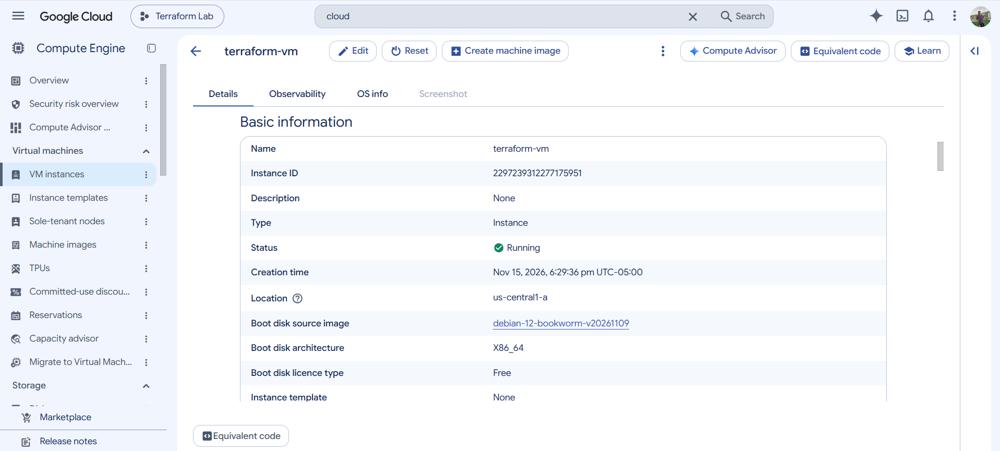
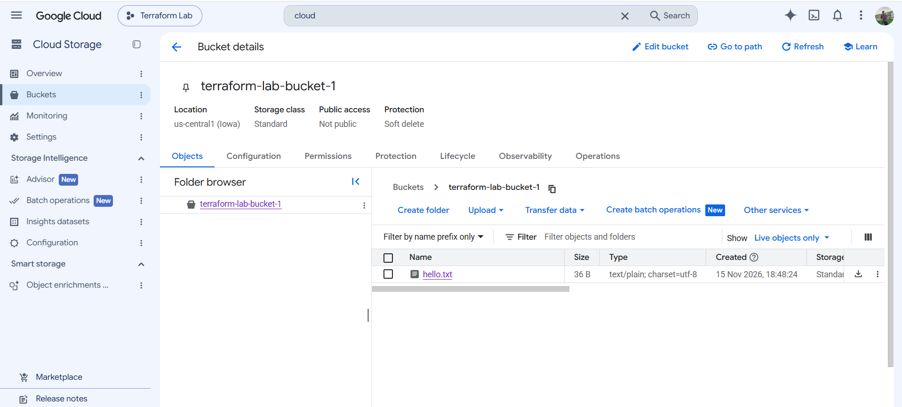

# Terraform Beginner Lab (GCP)

This lab uses Terraform to create, modify and destroy infrastructure on Google Cloud: a Compute Engine VM, a Cloud Storage bucket, and a text file uploaded to that bucket.

## What this lab builds

| Resource | Name | Details |
|---|---|---|
| Compute Engine VM | `terraform-vm` | `e2-micro`, Debian 12, 12 GB boot disk, `us-central1-a`, labels `environment=development` and `owner=team-terraform` |
| Cloud Storage bucket | `terraform-lab-bucket-1` | `us-central1`, uniform bucket-level access, public access blocked |
| Bucket object | `hello.txt` | A text file Terraform uploads into the bucket, containing the VM's name |

## Prerequisites

- A GCP account with billing enabled, and a project with a linked billing account.
- [Google Cloud CLI](https://cloud.google.com/sdk/docs/install) installed and configured.
- [Terraform](https://developer.hashicorp.com/terraform/install) installed on your local machine.
- A service account key (JSON) with the `Editor` role, or a logged-in Google account with access to the project.

Set up credentials and enable the required APIs:

```bash
# macOS / Linux
export GOOGLE_APPLICATION_CREDENTIALS="/path/to/your-key-file.json"
```

```powershell
# Windows PowerShell
$env:GOOGLE_APPLICATION_CREDENTIALS = "C:\path\to\your-key-file.json"
```

```bash
gcloud config set project terraform-lab-514821
gcloud services enable compute.googleapis.com storage.googleapis.com
```

## How to run

### Part 1: Set up Terraform

```bash
terraform --version
cd terraform-lab-gcp
terraform init
```

### Part 2: Apply and modify the VM

The VM uses the `debian-cloud/debian-12` image instead of the original lab's `debian-11`. Debian 11 has reached end of life and Google has removed its image family, so `terraform apply` fails with `Could not find image or family debian-cloud/debian-11`.

```bash
terraform plan
terraform apply
```

Type `yes` at the prompt, then check **Compute Engine → VM instances** in the GCP Console to see the VM. After changing the VM's machine type, labels or disk size in `main.tf`, run `terraform plan` and `terraform apply` again.

The VM resource includes one attribute that the original lab did not have:

- `allow_stopping_for_update = true`: GCP cannot change the machine type of a running VM. Without this attribute, changing `machine_type` from `f1-micro` to `e2-micro` fails with `Changing the machine_type ... on a started instance requires stopping it`. Setting it to `true` lets Terraform stop the VM, apply the change and start it again. The VM is briefly offline while this happens.

Changing the boot disk `size` does not resize the disk in place. Terraform destroys the VM and creates a new one. `terraform plan` shows this as `forces replacement`.

### Part 3: Add the bucket and hello.txt

Add the following to `main.tf`:

```hcl
resource "google_storage_bucket" "terraform-lab-bucket" {
  name                        = "terraform-lab-bucket-1"
  location                    = "us-central1"
  force_destroy               = true
  uniform_bucket_level_access = true
  public_access_prevention    = "enforced"
}

resource "google_storage_bucket_object" "readme" {
  name    = "hello.txt"
  bucket  = google_storage_bucket.terraform-lab-bucket.name
  content = "Created by Terraform on ${google_compute_instance.vm_instance.name}"
}
```

The bucket has two attributes that the original lab did not have:

- `uniform_bucket_level_access = true`: Access to the bucket is controlled only through IAM, not through per-object ACLs. This project's organization policy (`constraints/storage.uniformBucketLevelAccess`) requires it. Without it, bucket creation fails with `Error 412`.
- `public_access_prevention = "enforced"`: Blocks the bucket and its objects from ever being made public, even by mistake.

The `google_storage_bucket_object` resource is new. It uploads a file into the bucket:

- `name`: The file name in the bucket (`hello.txt`).
- `bucket`: The bucket to upload to. It refers to the bucket resource above as `google_storage_bucket.terraform-lab-bucket.name` instead of typing the name directly. The reference also tells Terraform the bucket must exist before the file is uploaded.
- `content`: The text written into the file. It includes the VM's name through `${google_compute_instance.vm_instance.name}`, so Terraform creates the file after the VM as well. Terraform uploads the file from the machine running `terraform apply`. The VM does not write it.

Then run:

```bash
terraform plan
terraform apply
```

Check **Cloud Storage → Buckets** in the GCP Console to see the bucket and `hello.txt`.

### Part 4: Destroy resources

```bash
terraform destroy
```

Type `yes` at the prompt, then confirm in the GCP Console that the resources are gone.

## Results

### Compute Engine VM



The VM `terraform-vm` was created by Terraform and is **Running** in `us-central1-a`, booted from the `debian-12-bookworm` image.

### Cloud Storage bucket and hello.txt



The bucket `terraform-lab-bucket-1` was created in `us-central1` with public access blocked. `hello.txt` was created successfully inside it by Terraform's `google_storage_bucket_object` resource.
